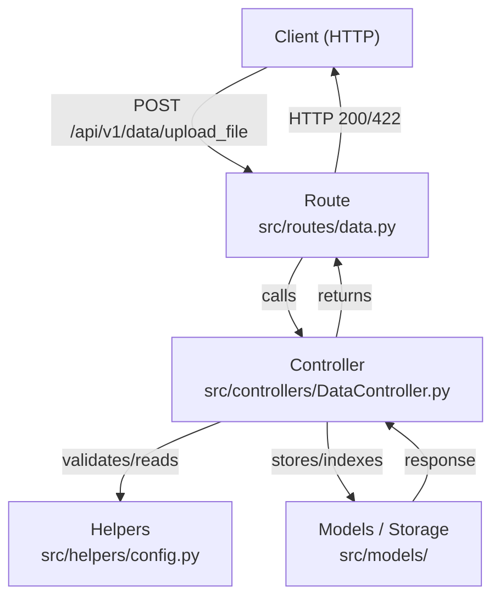
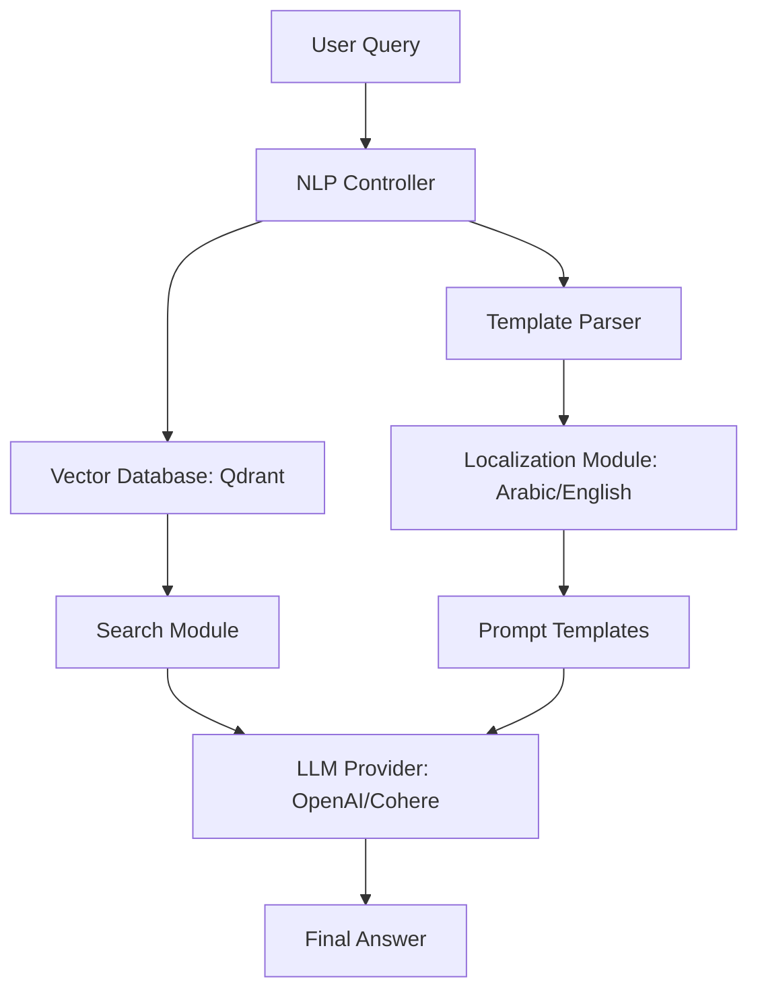

# simple-rag

A minimal Retrieval-Augmented Generation (RAG)-style assistant for local document ingestion, indexing, and retrieval — lightweight FastAPI service for uploading and validating documents.

## Features
- Upload and validate documents (`.txt`, `.pdf`)
- Simple routing → controller validation flow
- Config-driven file size limits
- Easy to extend with indexing/storage backends

## Repository layout
- src — application source
  - `routes/` — FastAPI routes (e.g., data upload)
  - `controllers/` — business logic and validation
  - `helpers/` — config and utility helpers
  - `enums/` — enumerations (e.g., allowed file types)
  - `models/` — data models / storage adapters
- docker — compose and container configs

## Quickstart (Windows)
1. Create and activate venv
```powershell
python -m venv .venv
.venv\Scripts\activate
```
2. Install dependencies
```powershell
pip install -r src/requirements.txt
```
3. Run dev server
```powershell
uvicorn src.main:app --reload
```

## API
- POST /api/v1/data/upload_file/{project_id}
  - Form field: `file` (multipart/form-data)
  - Example curl:
```bash
curl -X POST "http://localhost:8000/api/v1/data/upload_file/1" \
  -F "file=@/path/to/file.pdf"
```
- Response: JSON with validation message and status.

## File upload notes / implementation hints
- FastAPI expects form file fields for uploads:
  - Route signature should use `file: UploadFile = File(...)`
- `UploadFile` is async; to get size use:
```python
contents = await file.read()
size = len(contents)
```
(reading consumes the stream — seek/reset if you need to re-read)
- Allowed types are declared via enum values (example in ProcessEnums.py):
```python
from enums import ProcessEnum
allowed = [item.value for item in ProcessEnum]
```

## Mermaid flow


## Development notes
- Add docstrings to routes and controllers to make autogenerated docs useful.
- Consider adding a script (e.g., `scripts/generate_docs.py`) to extract endpoints and docstrings into `docs/`.
- For automatic docs updates on repo changes, use a CI job that runs the generator and commits updated docs.

## Contributing
- Add tests for new endpoints and validation logic.
- Update this README.md when adding new API behavior or config options.

## License
See LICENSE in the repository root.

---

The project structure for this *mini-RAG* application (Retrieval-Augmented Generation) is designed to modularize core components like LLM providers, vector databases, and prompt management. Below is a flowchart representing the high-level architecture:



### Key Components Breakdown:

*   **NLP Controller:** Acts as the central orchestrator that receives the user query and coordinates between the template parser and the vector database.
*   **Template Parser:** Manages localized system, document, and footer prompts based on the selected language configuration.
*   **Vector Database (Qdrant):** Responsible for storing and searching text chunks. The search module retrieves relevant context based on the user's input.
*   **LLM Provider:** An abstracted layer (supporting OpenAI or Cohere) that takes the retrieved document chunks and the formatted prompt to generate an answer.
*   **Localization:** A system that dynamically switches between Arabic and English templates (stored in `localized` folders) based on the application configuration.