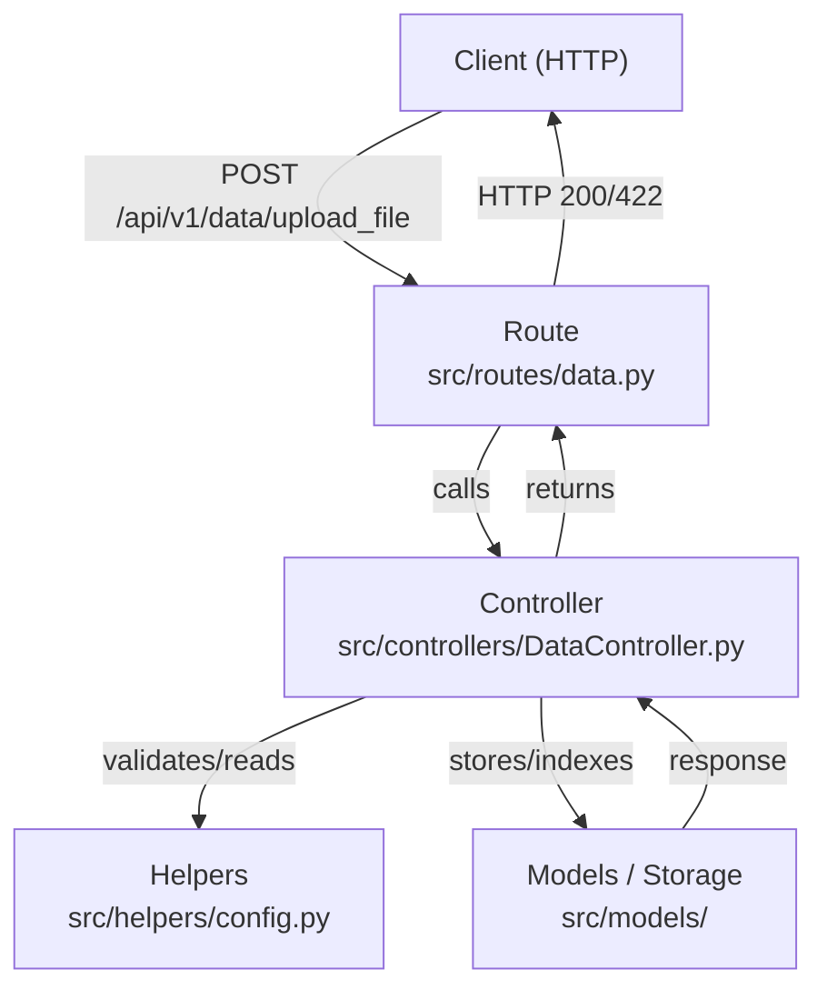
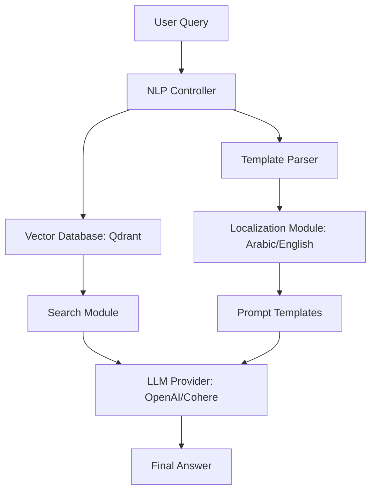

# simple-rag

A minimal Retrieval-Augmented Generation (RAG)-style assistant for local document ingestion, indexing, and retrieval — lightweight FastAPI service for uploading and validating documents.

## Features
- Upload and validate documents (`.txt`, `.pdf`)
- Simple routing → controller validation flow
- Config-driven file size limits
- Easy to extend with indexing/storage backends

## Repository layout
- src — application source
  - `routes/` — FastAPI routes (e.g., data upload)
  - `controllers/` — business logic and validation
  - `helpers/` — config and utility helpers
  - `enums/` — enumerations (e.g., allowed file types)
  - `models/` — data models / storage adapters
- docker — compose and container configs

## Quickstart (Windows)
Run these commands from the repository root.

1. Create and activate a virtual environment
```powershell
python -m venv .venv
.venv\Scripts\activate
```
2. Install dependencies
```powershell
pip install -r requirements.txt
```
3. Configure the application
```powershell
Copy-Item src\.env.example src\.env
```
Edit `src/.env` and set your PostgreSQL connection string and OpenAI API key.
The database must exist and have PostgreSQL with the pgvector extension
available. Ensure `alembic.ini` points to the same database, then create the
application tables:
```powershell
alembic upgrade head
```
4. Run the development server
```powershell
uvicorn main:app --reload
```

## API
- POST /api/v1/data/upload_file/{project_id}
  - Form field: `file` (multipart/form-data)
  - Example curl:
```bash
curl -X POST "http://localhost:8000/api/v1/data/upload_file/1" \
  -F "file=@/path/to/file.pdf"
```
- Response: JSON with validation message and status.
- Vector search and RAG answer requests require non-blank text up to 4,000
  characters. Their `limit` defaults to 5 and must be between 1 and 20.
- The file processing and vector indexing requests use a boolean `do_reset`
  field, defaulting to `false`.

## File upload notes / implementation hints
- FastAPI expects form file fields for uploads:
  - Route signature should use `file: UploadFile = File(...)`
- `UploadFile` is async; to get size use:
```python
contents = await file.read()
size = len(contents)
```
(reading consumes the stream — seek/reset if you need to re-read)
- Allowed types are declared via enum values (example in ProcessEnums.py):
```python
from enums import ProcessEnum
allowed = [item.value for item in ProcessEnum]
```

## Mermaid flow


## Development notes
- Add docstrings to routes and controllers to make autogenerated docs useful.
- Consider adding a script (e.g., `scripts/generate_docs.py`) to extract endpoints and docstrings into `docs/`.
- For automatic docs updates on repo changes, use a CI job that runs the generator and commits updated docs.

## Async PostgreSQL connections and sessions

The pgvector provider uses SQLAlchemy's `AsyncEngine` and asyncpg driver. The
engine is created once when the provider connects and maintains a connection
pool. Each provider operation uses `async with engine.connect()` for reads or
`async with engine.begin()` for writes. These context managers check out a
connection from the pool and return it when the operation finishes; they do not
necessarily establish a new network connection on every call. `engine.begin()`
also commits on success and rolls back if an exception occurs.

An alternative is to use `async with session_factory() as session`, where the
factory creates SQLAlchemy `AsyncSession` objects. Choose a session when working
with ORM models, tracking changes, or coordinating several ORM operations in a
unit of work. A session can also execute raw SQL, but that ORM-oriented
functionality is unnecessary for the pgvector provider's SQLAlchemy Core
queries. For those queries, using the engine directly is simpler. Use
`async with session.begin()` when a session-based group of operations needs an
explicit transaction.

Do not share one `AsyncSession` across concurrent requests or keep a session
open for the lifetime of the provider. Sessions are mutable and should be
created for a request or unit of work. Keeping the `AsyncEngine` on the provider
is appropriate because it manages the pool.

The application disables SQLAlchemy statement echoing by default to avoid
logging SQL parameters that may contain user data. The async database engine,
vector database client, and LLM clients are closed during application shutdown,
including when startup fails after a resource has been created.

The vector provider methods are asynchronous, so callers must await them
(for example, `await provider.search_by_embedding(...)`). The application
lifecycle and vector controller use asynchronous APIs for both pgvector and Qdrant.
Embedding and text-generation requests are asynchronous as well.

Document embedding uses each provider's batch API. Indexing sends at most 64
texts per embedding request and preserves the input order when pairing vectors
with chunks. Vector database writes are also batched by the provider.

## Pgvector chunk references

When indexing with pgvector, each vector row stores the source `asset_chunks`
database `chunk_id` in a separate, unique column. Search results include that
`chunk_id` alongside the text and similarity score, allowing the result to be
looked up in the chunk table. A foreign key references
`asset_chunks.chunk_id`; deleting a source chunk cascades to its vector record.

The foreign key is created when a new collection is created; existing
collections are not altered automatically. Drop and recreate an older
collection (then reindex it) to add the `chunk_id` column and foreign key.

## Pgvector ANN indexes

Pgvector collections use HNSW by default. The application creates the ANN index
after all chunks in an indexing request have been inserted, so the initial
bulk load does not pay the index-maintenance cost for every row. Later inserts
keep the existing index up to date; it is not rebuilt on every request.

When `do_reset` is enabled for vector indexing, the replacement is built in a
staging collection. The old collection remains available until all chunks are
inserted and index setup completes. PostgreSQL publishes the replacement in a
transaction; Qdrant switches an alias to the completed collection. Failed
rebuilds remove the staging collection and leave the current collection active.

Set `PGVECTOR_INDEX_TYPE` to `hnsw` or `ivfflat` to choose the configured index
type. The next successful indexing request creates the configured index before
dropping the previous index managed by this provider. This makes the change
explicit and avoids dropping the old index if creation of the replacement
fails. IVFFlat's `lists` value is estimated from the collection's row count;
HNSW uses pgvector's defaults.

The index operator class follows `VECTOR_DB_DISTANCE_METRIC` (cosine or dot
product). Index type changes can take time and use additional storage while the
replacement builds, so benchmark against representative queries and schedule
large changes appropriately. The current implementation uses regular
transactional `CREATE INDEX`, not `CREATE INDEX CONCURRENTLY`.

## Arabic and English chunking

Document processing uses a recursive, structure-aware splitter. It prefers
paragraph and line breaks, then Arabic sentence punctuation (`؟`, `؛`, `۔`),
English sentence endings, commas, and finally spaces or character boundaries.
This keeps sentence and word boundaries when possible, while still respecting
the requested maximum chunk size. Loader metadata is preserved, and each
resulting chunk records its source start offset.

`chunk_size` and `overlap_size` are measured in **characters**, not tokens.
Defaults are 1,000 characters with 150 characters of overlap. These are starting
values rather than universal optima: benchmark retrieval quality on the actual
Arabic and English documents and embedding model. The project does not
currently configure a model-specific tokenizer, so token counts are not
guaranteed by these limits. Requests reject non-positive sizes, overlap greater
than or equal to the chunk size, and sizes above 8,192 characters.

## Contributing
- Add tests for new endpoints and validation logic.
- Update this README.md when adding new API behavior or config options.

## License
See LICENSE in the repository root.

---

The project structure for this *mini-RAG* application (Retrieval-Augmented Generation) is designed to modularize core components like LLM providers, vector databases, and prompt management. Below is a flowchart representing the high-level architecture:



### Key Components Breakdown:

*   **NLP Controller:** Acts as the central orchestrator that receives the user query and coordinates between the template parser and the vector database.
*   **Template Parser:** Manages localized system, document, and footer prompts based on the selected language configuration.
*   **Vector Database (Qdrant):** Responsible for storing and searching text chunks. The search module retrieves relevant context based on the user's input.
*   **LLM Provider:** An abstracted layer (supporting OpenAI or Cohere) that takes the retrieved document chunks and the formatted prompt to generate an answer.
*   **Localization:** A system that dynamically switches between Arabic and English templates (stored in `localized` folders) based on the application configuration.