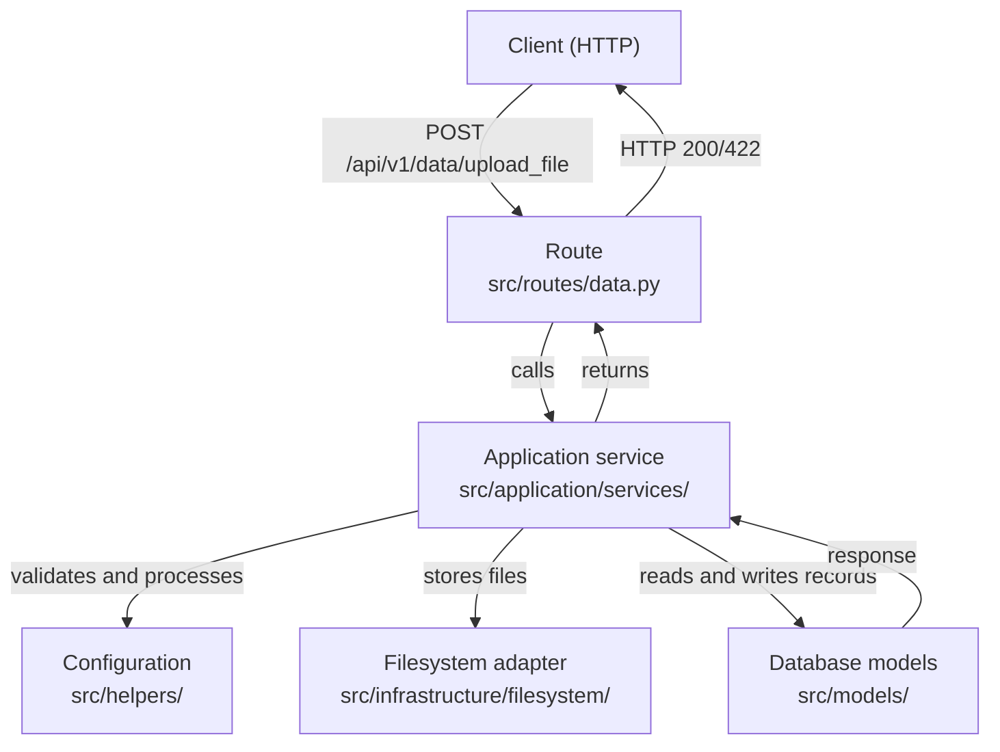
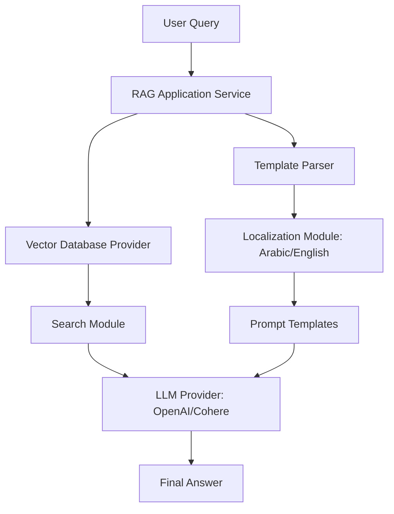

# simple-rag

A minimal Retrieval-Augmented Generation (RAG)-style assistant for local document ingestion, indexing, and retrieval — lightweight FastAPI service for uploading and validating documents.

## Features
- Upload and validate documents (`.txt`, `.pdf`)
- FastAPI routes delegate workflows to application services
- Config-driven file size limits
- Easy to extend with indexing/storage backends

## Application tree

```text
simple-rag/
├── docker/
│   ├── docker-compose.yml
│   ├── .env.example
│   └── RAG/
│       ├── Dockerfile
│       ├── entrypoint.sh
│       └── env/
├── alembic.ini
├── alembic/
│   ├── env.py
│   └── versions/
├── src/
│   ├── __init__.py
│   ├── main.py
│   ├── requirements.txt
│   ├── application/
│   │   └── services/
│   │       ├── data_service.py
│   │       ├── document_processing_service.py
│   │       └── rag_service.py
│   ├── enums/
│   ├── helpers/
│   ├── infrastructure/
│   │   ├── database/repositories/
│   │   │   ├── asset_repository.py
│   │   │   ├── chunk_repository.py
│   │   │   └── project_repository.py
│   │   └── filesystem/storage_paths.py
│   ├── models/
│   │   ├── db_schemes/
│   │   └── vector_schemes.py
│   ├── routes/
│   ├── schemas/
│   ├── stores/
│   │   ├── llm/
│   │   │   ├── providers/
│   │   │   └── templates/locales/{ar,en}/
│   │   └── vectordb/providers/
│   ├── .env.example
│   └── assets/sample_files/
├── tests/
└── data/                       # Runtime data; git-ignored
    ├── uploaded_files/
    └── vector_db/
```

Runtime uploads and local vector-store data are stored under the configurable
`DATA_DIR` (default: repository-root `data/`), outside the source package.
Existing files under `src/assets/` are not migrated automatically.

## Structure and hierarchy

| Layer / directory | Responsibility | Typical contents |
|---|---|---|
| `src/main.py` | Application entry point and lifespan wiring | FastAPI app, provider setup and shutdown |
| `src/routes/` | HTTP boundary | Request parsing, service calls, response/status mapping |
| `src/schemas/` | API input validation | Pydantic request schemas |
| `src/application/services/` | Application workflows | Upload/registration, document processing, vector indexing and RAG |
| `src/infrastructure/database/repositories/` | Database persistence | SQLAlchemy queries and writes for projects, assets and chunks |
| `src/infrastructure/filesystem/` | Local storage support | Runtime upload and vector-store paths |
| `src/stores/` | External service adapters | LLM and vector database interfaces, factories and providers |
| `src/models/` | Data definitions | ORM table schemas and provider-neutral models |
| `src/helpers/`, `src/enums/` | Shared application support | Configuration, database session dependency and enum values |
| `alembic/` | Database schema migrations | Migration environment and version scripts |
| `tests/` | Automated verification | Unit tests for settings, storage paths and application services |
| `data/` | Runtime-only persistent files | Uploaded documents and local Qdrant data; excluded from Git |

## Quickstart (Windows)
Run these commands from the repository root.

1. Create and activate a virtual environment
```powershell
python -m venv .venv
.venv\Scripts\activate
```
2. Install dependencies
```powershell
pip install -r src/requirements.txt
```
3. Configure the application
```powershell
Copy-Item src\.env.example src\.env
```
Edit `src/.env` and set your PostgreSQL connection string and OpenAI API key.
Runtime uploads and local Qdrant data are written under `DATA_DIR` (default:
`data/` at the repository root). Existing files under `src/assets/` are left
untouched and are not migrated automatically.
Scanned PDFs require Tesseract OCR installed on the machine running the app.
The app looks for Tesseract on `PATH` and in the standard Windows install
directory. If it is installed elsewhere, set `TESSERACT_CMD` and optionally
`TESSDATA_DIR` in `src/.env`. Install the language packs selected by
`OCR_LANGUAGES` (default: `eng+ara`). PDFs with extractable text do not require
OCR. The example paths assume the standard Windows installation directory.
The database must exist and have PostgreSQL with the pgvector extension
available. Ensure `alembic.ini` points to the same database, then create the
application tables:
```powershell
alembic upgrade head
```
4. Run the development server
```powershell
uvicorn src.main:app --reload
```

## Docker deployment (FastAPI + pgvector)

The main Compose file runs the API, PostgreSQL with pgvector, Nginx, Qdrant,
Prometheus, Grafana, and node/PostgreSQL exporters. The Celery worker, scheduler,
Flower, RabbitMQ, and Redis services are not included yet because the repository
does not currently contain their task-queue application code/configuration.

From the repository root, create any missing environment files from the
examples. This preserves existing local secrets:

```powershell
$envDir = "docker\RAG\env"
@(
  ".env.app",
  ".env.postgres",
  ".env.grafana",
  ".env.postgres-exporter"
) | ForEach-Object {
  $target = Join-Path $envDir $_
  $example = "$target.example"
  if (-not (Test-Path $target)) {
    Copy-Item $example $target
  }
}
```

Set a strong PostgreSQL password in `.env.postgres` and use matching credentials
and the Compose hostname `pgvector` in the `.env.app` `POSTGRES_URI`. Replace
the example LLM API key as well. For production, create a dedicated PostgreSQL
monitoring user and put its credentials in `.env.postgres-exporter`; do not use
the PostgreSQL superuser for exporter access:

```sql
CREATE USER postgres_exporter WITH PASSWORD '<strong-password>';
GRANT pg_monitor TO postgres_exporter;
```

Set a unique Grafana admin password. URL-encode any special characters in the
password inside `POSTGRES_URI`. Grafana provisions the Prometheus datasource and
the Simple RAG overview dashboard automatically. Then build and start the
services from the repository root:

```powershell
docker compose -f docker\docker-compose.yml up --build
```

Nginx exposes the API on port 80. Grafana and Prometheus are bound to localhost
on ports 3000 and 9090; PostgreSQL, Qdrant, and exporters are only available on
the Compose network. Uploads and database files are persisted in Docker
volumes. The image includes Tesseract and English/Arabic language data for
scanned PDFs. Configure TLS at the reverse proxy before exposing this stack
to the public internet. Nginx blocks external access to `/metrics`; Prometheus
scrapes the endpoint directly over the private Compose network. The container
runs Alembic migrations before starting FastAPI; a failed migration prevents
the API from starting. Compose probes `/health`, which checks PostgreSQL
connectivity before marking the API healthy.

## API
- POST /api/v1/data/upload_file/{project_id}
  - Form field: `file` (multipart/form-data)
  - Example curl:
```bash
curl -X POST "http://localhost:8000/api/v1/data/upload_file/1" \
  -F "file=@/path/to/file.pdf"
```
- Response: JSON with validation message and status.
- Vector search and RAG answer requests require non-blank text up to 4,000
  characters. Their `limit` defaults to 5 and must be between 1 and 20.
- The file processing and vector indexing requests use a boolean `do_reset`
  field, defaulting to `false`.

## File upload notes / implementation hints
- FastAPI expects form file fields for uploads:
  - Route signature should use `file: UploadFile = File(...)`
- `UploadFile` is async; to get size use:
```python
contents = await file.read()
size = len(contents)
```
(reading consumes the stream — seek/reset if you need to re-read)
- Allowed types are declared via enum values (see `src/enums/process_enums.py`):
```python
from src.enums import ProcessEnum
allowed = [item.value for item in ProcessEnum]
```

## Mermaid flow


## Development notes
- Run the unit tests from the repository root with
  `python -m unittest discover -s tests -v`.
- Add docstrings to routes and application services to make autogenerated docs useful.
- Consider adding a script (e.g., `scripts/generate_docs.py`) to extract endpoints and docstrings into `docs/`.
- For automatic docs updates on repo changes, use a CI job that runs the generator and commits updated docs.

Runtime operation timings are written to the application log with an operation
name, completion status, elapsed seconds, and safe identifiers such as project
or asset IDs. Indexing logs separate chunk reads, embedding, vector upserts,
index creation, and collection publication; document upload and processing,
search, and answer generation are timed as well.
Prometheus request counters and latency histograms are exposed at `/metrics`.
Restrict this endpoint to trusted monitoring clients at the network or proxy
layer before exposing the application beyond a trusted environment.

## Planned features

The following conversational RAG capabilities are planned and are not
implemented yet:

- Persist conversations and their user/assistant messages in PostgreSQL.
- Add a `conversation_id` to answer requests. Create a conversation when one is
  not supplied, and return its ID so clients can continue it.
- Load only recent turns for a conversation, with a configurable history/token
  limit; consider summarizing older turns when the limit is reached.
- Retrieve relevant documents again for each new user message, and combine the
  results with the bounded conversation history and current question.
- Store a language preference per conversation. Allow clients to select it,
  otherwise detect the user's language and update it when they clearly switch.
- Select the prompt language per request/conversation rather than mutating the
  shared startup `TemplateParser`, so concurrent conversations remain isolated.
- Add tests for multi-turn follow-ups, language changes, history limits, and
  conversation isolation.
- RAG quality evaluation — Create a small set of representative questions and expected source documents; measure retrieval relevance and answer quality as the system changes.
- Citations in answers — Return source titles or links with answers, and make it clear when the retrieved documents don’t support a confident answer.
- Authentication and project access controls — Ensure users can only search and manage documents belonging to projects they’re authorized to access.
- Ingestion status and recovery — Track document processing states and surface failures so users can tell whether a file was indexed successfully and retry when needed.
- Integration tests — Cover API routes and repository behavior, including tests against PostgreSQL/pgvector and Qdrant where practical.
- Operational visibility — Add metrics, dashboards, and alerts for ingestion failures, retrieval latency, and LLM errors; operation duration logs are implemented.

## Async PostgreSQL connections and sessions

The pgvector provider uses SQLAlchemy's `AsyncEngine` and asyncpg driver. The
engine is created once when the provider connects and maintains a connection
pool. Each provider operation uses `async with engine.connect()` for reads or
`async with engine.begin()` for writes. These context managers check out a
connection from the pool and return it when the operation finishes; they do not
necessarily establish a new network connection on every call. `engine.begin()`
also commits on success and rolls back if an exception occurs.

An alternative is to use `async with session_factory() as session`, where the
factory creates SQLAlchemy `AsyncSession` objects. Choose a session when working
with ORM models, tracking changes, or coordinating several ORM operations in a
unit of work. A session can also execute raw SQL, but that ORM-oriented
functionality is unnecessary for the pgvector provider's SQLAlchemy Core
queries. For those queries, using the engine directly is simpler. Use
`async with session.begin()` when a session-based group of operations needs an
explicit transaction.

Do not share one `AsyncSession` across concurrent requests or keep a session
open for the lifetime of the provider. Sessions are mutable and should be
created for a request or unit of work. Keeping the `AsyncEngine` on the provider
is appropriate because it manages the pool.

The application disables SQLAlchemy statement echoing by default to avoid
logging SQL parameters that may contain user data. The async database engine,
vector database client, and LLM clients are closed during application shutdown,
including when startup fails after a resource has been created.

The vector provider methods are asynchronous, so callers must await them
(for example, `await provider.search_by_embedding(...)`). The application
lifecycle and vector controller use asynchronous APIs for both pgvector and Qdrant.
Embedding and text-generation requests are asynchronous as well.

Document embedding uses each provider's batch API. Indexing sends at most 64
texts per embedding request and preserves the input order when pairing vectors
with chunks. Vector database writes are also batched by the provider.

## Pgvector chunk references

When indexing with pgvector, each vector row stores the source `asset_chunks`
database `chunk_id` in a separate, unique column. Search results include that
`chunk_id` alongside the text and similarity score, allowing the result to be
looked up in the chunk table. A foreign key references
`asset_chunks.chunk_id`; deleting a source chunk cascades to its vector record.

The foreign key is created when a new collection is created; existing
collections are not altered automatically. Drop and recreate an older
collection (then reindex it) to add the `chunk_id` column and foreign key.

## Pgvector ANN indexes

Pgvector collections use HNSW by default. The application creates the ANN index
after all chunks in an indexing request have been inserted, so the initial
bulk load does not pay the index-maintenance cost for every row. Later inserts
keep the existing index up to date; it is not rebuilt on every request.

When `do_reset` is enabled for vector indexing, the replacement is built in a
staging collection. The old collection remains available until all chunks are
inserted and index setup completes. PostgreSQL publishes the replacement in a
transaction; Qdrant switches an alias to the completed collection. Failed
rebuilds remove the staging collection and leave the current collection active.

Set `PGVECTOR_INDEX_TYPE` to `hnsw` or `ivfflat` to choose the configured index
type. The next successful indexing request creates the configured index before
dropping the previous index managed by this provider. This makes the change
explicit and avoids dropping the old index if creation of the replacement
fails. IVFFlat's `lists` value is estimated from the collection's row count;
HNSW uses pgvector's defaults.

The index operator class follows `VECTOR_DB_DISTANCE_METRIC` (cosine or dot
product). Index type changes can take time and use additional storage while the
replacement builds, so benchmark against representative queries and schedule
large changes appropriately. The current implementation uses regular
transactional `CREATE INDEX`, not `CREATE INDEX CONCURRENTLY`.

## Arabic and English chunking

Document processing uses a recursive, structure-aware splitter. It prefers
paragraph and line breaks, then Arabic sentence punctuation (`؟`, `؛`, `۔`),
English sentence endings, commas, and finally spaces or character boundaries.
This keeps sentence and word boundaries when possible, while still respecting
the requested maximum chunk size. Loader metadata is preserved, and each
resulting chunk records its source start offset.

`chunk_size` and `overlap_size` are measured in **characters**, not tokens.
Defaults are 1,000 characters with 150 characters of overlap. These are starting
values rather than universal optima: benchmark retrieval quality on the actual
Arabic and English documents and embedding model. The project does not
currently configure a model-specific tokenizer, so token counts are not
guaranteed by these limits. Requests reject non-positive sizes, overlap greater
than or equal to the chunk size, and sizes above 8,192 characters.

## Contributing
- Add tests for new endpoints and validation logic.
- Update this README.md when adding new API behavior or config options.

## License
See LICENSE in the repository root.

---

The project structure for this *mini-RAG* application (Retrieval-Augmented Generation) is designed to modularize core components like LLM providers, vector databases, and prompt management. Below is a flowchart representing the high-level architecture:



### Key Components Breakdown:

*   **RAG Application Service:** Coordinates embedding, vector search, prompt construction, and answer generation.
*   **Template Parser:** Manages localized system, document, and footer prompts based on the selected language configuration.
*   **Vector Database Provider:** Stores and searches text chunks using the configured Qdrant or pgvector backend.
*   **LLM Provider:** An abstracted layer (supporting OpenAI or Cohere) that takes the retrieved document chunks and the formatted prompt to generate an answer.
*   **Localization:** A system that dynamically switches between Arabic and English templates (stored in `localized` folders) based on the application configuration.